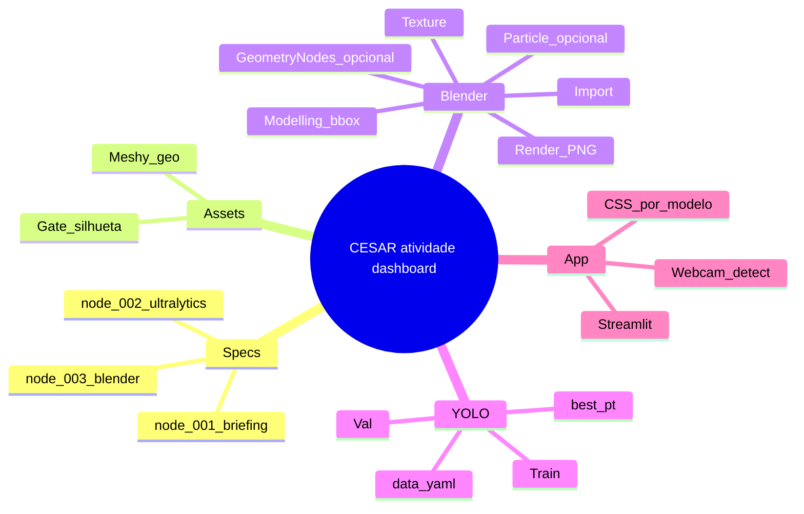
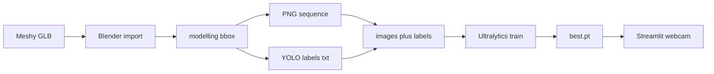

# node_000 — Pipeline mind map + passo a passo

Regra: script sem passo a passo documentado **não é script**.  
Cada `node_*.py` carrega `PASSO_A_PASSO` + `MINDMAP`. Este arquivo é o mapa do show inteiro.

## Mind map (show)

## Fluxo (quem produz → contrato → quem consome)

## Passo a passo do show (ordem)

1. **Specs** — ler `node_001_briefing.md`. Contrato: 3 BYD, detect bbox, Streamlit.
2. **Meshy** — gerar 3 meshes. Gate: olho separa lateral / 3-4 frente / 3-4 trás.
3. **Blender import** — `node_003_blender_import.py`. Naming `byd_<modelo>_v001`.
4. **Modelling** — `node_003_blender_modelling.py`. Escala metros, origin, bbox→YOLO.
5. **Texture** — `node_003_blender_texture.py`. Paint / maps só se ajudar domain.
6. **Particle / GN** — opcional FX (`particle`, `geometry_nodes`). **Não** gera label.
7. **Render** — PNG + `.txt` label por frame (mesmo stem).
8. **Dataset** — layout em `node_002_ultralytics.*` + `data.yaml` 3 classes.
9. **Train / val** — Ultralytics detect. Um `best.pt`.
10. **Streamlit** — sidebar CSS; `predict(source=0)`; filtra classe ativa.

## Índice dos nodes

| Node | Arquivo | Papel |
|------|---------|--------|
| 000 | `node_000_pipeline_mindmap.md` | mapa + ordem |
| 001 | `node_001_briefing.md` | brief |
| 002 | `node_002_ultralytics.md` + `.py` | YOLO cheat |
| 003 | `node_003_blender.py` + tasks | bpy por task |
| — | `node_object_detection.md` + `.py` | detect detalhado + OpenCV + import |

## Fora de escopo (não entra no caminho crítico)

- Crypto matte / ID pass
- Segmentation YOLO
- Três `.pt` separados (default = um weights, três classes)
