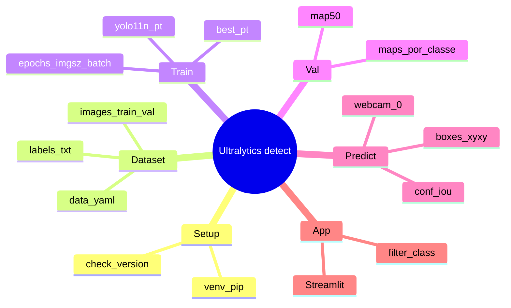

# node_002 — Ultralytics (YOLO)

Versão alvo no `.venv` do projeto: **8.4.191**  
Docs oficiais: https://docs.ultralytics.com/  
Repo: https://github.com/ultralytics/ultralytics  
Irmão executável/cheat: [`node_002_ultralytics.py`](node_002_ultralytics.py)  
Mapa do show: [`node_000_pipeline_mindmap.md`](node_000_pipeline_mindmap.md)

Contrato deste show: **detection** (`classe + bbox`). Sem segmentation, sem crypto matte.

---

## Mind map



## Passo a passo (este node)

1. Ativar `.venv` e confirmar `import ultralytics` → `8.4.191`.
2. Montar pastas `images/{train,val}` + `labels/{train,val}` (stem igual).
3. Escrever `data.yaml` com `path`, splits e `names` 0..2 (3 BYD).
4. Conferir **uma** label à mão: `class_id cx cy w h` todos em 0–1.
5. `yolo detect train ...` ou `YOLO(...).train(...)` → anotar pasta `runs/...`.
6. `val` → ler `map50` **por classe**; classe fraca = mais dados, não mais epochs cego.
7. `predict(source=0, stream=True)` → ler `boxes.xyxy/conf/cls`.
8. Congelar `best.pt` no app; Streamlit só escolhe CSS + `classes=[id]`.

Script sem esses passos no docstring/`PASSO_A_PASSO` **não é script**.

---

## 1. Instalação

```bash
# neste projeto
.\.venv\Scripts\python.exe -m pip install ultralytics

# check
.\.venv\Scripts\python.exe -c "import ultralytics; print(ultralytics.__version__)"
```

Dependências puxadas pelo pacote: `torch`, `torchvision`, `opencv-python`, `numpy`, `pillow`, `pyyaml`, `matplotlib`, `polars`, etc.

GPU: CUDA do PyTorch precisa bater com o driver. CPU funciona; treino fica lento.

---

## 2. Conceitos

| Termo | Significado |
|-------|-------------|
| `model` | Wrapper YOLO (`.pt` / `.yaml`) |
| `task` | `detect`, `segment`, `classify`, `pose`, `obb` |
| `mode` | `train`, `val`, `predict`, `export`, `track`, `benchmark` |
| `data.yaml` | Contrato do dataset (paths + nomes de classe) |
| `imgsz` | Lado do resize (ex. 640) |
| `batch` | Imagens por step |
| `epochs` | Passes no train set |
| `device` | `cpu`, `0`, `0,1`, `mps` |
| `project` / `name` | Pasta de runs (`runs/detect/train`) |
| `weights` | Checkpoint `.pt` |

Para BYD: **1 modelo, 3 classes** (um `.pt`). Streamlit troca CSS/tema; não precisa 3 weights.

---

## 3. Dataset (detect)

Layout YOLO:

```text
datasets/byd/
  images/
    train/
    val/
    test/          # opcional
  labels/
    train/
    val/
    test/
  data.yaml
```

Label por imagem: mesmo stem, extensão `.txt`.

Formato de linha (normalizado 0–1):

```text
class_id cx cy w h
```

- `class_id`: int, índice em `names` do yaml (0-based)
- `cx cy`: centro do bbox / largura e altura da imagem
- `w h`: largura e altura do bbox / tamanho da imagem

Várias linhas = várias detecções na mesma frame.

Exemplo `data.yaml`:

```yaml
path: datasets/byd
train: images/train
val: images/val
test: images/test

names:
  0: byd_model_a
  1: byd_model_b
  2: byd_model_c

# opcional
# download: # url
# nc: 3
```

Conversão pixel → YOLO:

```python
def xyxy_to_yolo(x1, y1, x2, y2, img_w, img_h):
    cx = ((x1 + x2) / 2) / img_w
    cy = ((y1 + y2) / 2) / img_h
    w = (x2 - x1) / img_w
    h = (y2 - y1) / img_h
    return cx, cy, w, h
```

---

## 4. CLI

Entrypoint: `yolo` (no venv: `.\.venv\Scripts\yolo.exe`).

```bash
# treino
yolo detect train data=datasets/byd/data.yaml model=yolo11n.pt epochs=100 imgsz=640 batch=16 device=0

# validação
yolo detect val model=runs/detect/train/weights/best.pt data=datasets/byd/data.yaml

# inferência
yolo detect predict model=runs/detect/train/weights/best.pt source=0          # webcam
yolo detect predict model=best.pt source=path/to/img_or_dir_or_video
yolo detect predict model=best.pt source=rtsp://...

# export
yolo export model=best.pt format=onnx
yolo export model=best.pt format=engine device=0   # TensorRT se disponível
```

Args comuns: `conf=0.25`, `iou=0.7`, `save=True`, `save_txt=True`, `save_crop=True`, `show=True`, `project=`, `name=`, `exist_ok=True`, `workers=8`, `patience=50`, `lr0=0.01`, `pretrained=True`, `optimizer=auto`, `cos_lr=False`, `augment=True`.

Listar settings:

```bash
yolo settings
yolo settings runs_dir=path/to/dir
```

Arquivo típico Windows: `%APPDATA%\Ultralytics\settings.json`

---

## 5. Python API

### 5.1 Load

```python
from ultralytics import YOLO

model = YOLO("yolo11n.pt")              # pretrained COCO detect
model = YOLO("yolo11n.yaml")            # arch sem weights
model = YOLO("runs/detect/train/weights/best.pt")
```

Famílias comuns (n/s/m/l/x): `yolov8*`, `yolo11*`. Nano (`n`) = rápido pra iterar; `m`/`l` = mais mAP, mais VRAM.

### 5.2 Train

```python
from ultralytics import YOLO

model = YOLO("yolo11n.pt")
results = model.train(
    data="datasets/byd/data.yaml",
    epochs=100,
    imgsz=640,
    batch=16,
    device=0,           # ou "cpu"
    project="runs/byd",
    name="detect_v001",
    exist_ok=False,
    patience=50,
    save=True,
    plots=True,
    pretrained=True,
)
```

Saídas típicas em `runs/byd/detect_v001/`:

- `weights/best.pt`, `weights/last.pt`
- `results.csv`, curves PNG
- `args.yaml` (replay do treino)

### 5.3 Val

```python
metrics = model.val(data="datasets/byd/data.yaml")
print(metrics.box.map)    # mAP50-95
print(metrics.box.map50)  # mAP50
print(metrics.box.maps)   # mAP por classe
```

### 5.4 Predict

```python
from ultralytics import YOLO

model = YOLO("best.pt")

# imagem / pasta / vídeo / webcam (0) / URL
results = model.predict(
    source=0,
    conf=0.35,
    iou=0.5,
    imgsz=640,
    device=0,
    stream=True,      # gerador: webcam / vídeo longo
    save=False,
    show=False,
    classes=None,     # ex. [0] só classe 0
    verbose=False,
)

for r in results:
    boxes = r.boxes
    if boxes is None:
        continue
    xyxy = boxes.xyxy.cpu().numpy()   # (N, 4) pixel
    conf = boxes.conf.cpu().numpy()   # (N,)
    cls = boxes.cls.cpu().numpy()     # (N,)
    names = r.names                   # {id: str}
    # r.plot() -> ndarray BGR anotado
```

Objetos úteis em `Results`:

| Atributo | Uso |
|----------|-----|
| `boxes` | `Boxes` (xyxy, conf, cls, id) |
| `names` | dict classe |
| `path` | source path |
| `orig_img` | frame BGR |
| `speed` | preprocess / inference / postprocess ms |
| `plot()` | frame desenhado |
| `save_txt()` / `save_crop()` | I/O auxiliar |

`Boxes` tensors: `.xyxy`, `.xywh`, `.xyxyn`, `.xywhn`, `.conf`, `.cls`, `.id` (track).

### 5.5 Track (opcional)

```python
results = model.track(source=0, persist=True, tracker="bytetrack.yaml")
```

### 5.6 Export

```python
model.export(format="onnx", dynamic=False, simplify=True)
# formats: torchscript, onnx, openvino, engine, coreml, tflite, ...
```

### 5.7 Callbacks

```python
def on_train_epoch_end(trainer):
    print(trainer.epoch, trainer.metrics)

model.add_callback("on_train_epoch_end", on_train_epoch_end)
model.train(data="datasets/byd/data.yaml", epochs=10)
```

Hooks frequentes: `on_pretrain_routine_start`, `on_train_start`, `on_train_epoch_end`, `on_fit_epoch_end`, `on_model_save`, `on_train_end`, `on_predict_start`, `on_predict_batch_end`.

---

## 6. Streamlit (contrato futuro)

Padrão alinhado ao brief:

1. Sidebar escolhe modelo BYD (tema CSS).
2. Mesmo `.pt` com 3 classes; filtra `classes=[id]` ou highlight só da classe ativa.
3. `model.predict(source=0, stream=True)` no loop da câmera.
4. Desenha `xyxy` + label; CSS não entra no tensor.

Trocar 3 `.pt` só se cada carro tiver treino isolado. Default: **1 weights**.

---

## 7. Checklist de qualidade

- Train/val **sem leak** (frames da mesma sequência não nos dois lados).
- Silhuetas dos 3 BYD distinguíveis (gate Meshy antes do volume sintético).
- Domain gap CG→real: augment (`hsv`, `fliplr`, `mosaic`, …) + fotos reais no fine-tune.
- `imgsz` de predict = ordem de grandeza do train.
- Logar `map50` por classe; classe fraca = mais views / hard negatives.

---

## 8. Erros comuns

| Sintoma | Causa típica |
|---------|----------------|
| `Dataset not found` | `path` / `train` no yaml errado (cwd ≠ raiz) |
| mAP 0 | labels fora 0–1, `class_id` ≥ nc, imagem sem label pareada |
| CUDA OOM | baixar `batch` / `imgsz` / usar `yolo11n` |
| Webcam falha | índice `source` errado; outro app segura a câmera |
| Classes invertidas | ordem em `names` ≠ ids nos `.txt` |

---

## 9. Referência rápida de pesos

| Checkpoint | Task | Uso |
|------------|------|-----|
| `yolo11n.pt` | detect | bootstrap / edge |
| `yolo11s.pt` / `m.pt` | detect | mais acurácia |
| `yolo11n-seg.pt` | segment | **fora de escopo** neste show |
| `best.pt` | detect | produto após train BYD |

---

## 10. Links

- Tasks: https://docs.ultralytics.com/tasks/detect/
- Modes: https://docs.ultralytics.com/modes/
- CLI: https://docs.ultralytics.com/usage/cli/
- Python: https://docs.ultralytics.com/usage/python/
- CFG/args: https://docs.ultralytics.com/usage/cfg/
- Dataset YOLO: https://docs.ultralytics.com/datasets/detect/
