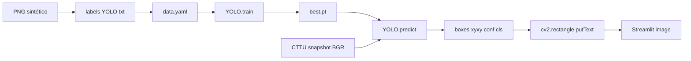
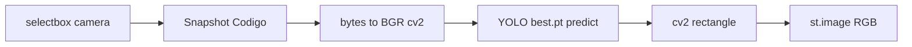

# node_object_detection — Ultralytics YOLO + OpenCV

Irmão cheat: [`node_object_detection.py`](node_object_detection.py)  
Cheat curto do show: [`node_002_ultralytics.md`](node_002_ultralytics.md)  
Uso no train: `stage_0030_training/node_002_training.ipynb`

Contrato CESAR-BYD: **object detection** = classe + bbox. Sem segmentation. Sem crypto.

---

## Fluxo (quem produz → contrato → quem consome)



---

## 1. Instalação (kernel / `.venv`)

Pacote correto: **`ultralytics`** (PyPI).  
**Não existe** `ultralytics_platform`. Esse nome quebra o import.

```bash
# no venv do projeto
.\.venv\Scripts\python.exe -m pip install ultralytics

# OpenCV vem como dependencia (opencv-python). Se faltar:
.\.venv\Scripts\python.exe -m pip install opencv-python

# check
.\.venv\Scripts\python.exe -c "from ultralytics import YOLO; import cv2; import ultralytics; print(ultralytics.__version__, cv2.__version__)"
```

No Jupyter: kernel = **mesmo** `.venv` onde instalou. Senão: `ModuleNotFoundError: No module named 'ultralytics'`.

Versão alvo do show (ver `node_002_ultralytics.py`): **8.4.191**.

---

## 2. Import certo (treino / predict)

```python
from ultralytics import YOLO

YOLO_MODEL = "yolo11n.pt"   # pretrained COCO — fine-tune
# ou pesos do show:
# YOLO_MODEL = r"C:\Python\CESAR-atividade_dashboard\stage_0030_training\EXPORT\V001\train\weights\best.pt"

model = YOLO(YOLO_MODEL)
```

Erros comuns:

| Errado | Por quê | Certo |
|--------|---------|-------|
| `from ultralytics_platform import YOLO` | pacote não existe | `from ultralytics import YOLO` |
| `import YOLO` | classe não é top-level | `from ultralytics import YOLO` |
| `from ultralytics import yolo` | API errada | `YOLO` (classe) |
| kernel sem pip no venv | ModuleNotFoundError | instalar no python do kernel |

`YOLO_MODEL` é **string/path** seu. Não importa de lugar nenhum — define na célula de hypers.

---

## 3. O que é object detection aqui

Uma detecção = **uma caixa** + **um class_id** + (na inferência) **conf**.

Label YOLO (treino), por linha, normalizado 0–1:

```text
class_id cx cy w h
```

Classes do experimento Dolphin:

```text
0: dolphin
1: trouble
```

OpenCV não treina. OpenCV **lê imagem** (BGR) e **desenha** bbox depois do YOLO.

---

## 4. Ultralytics — API que você usa

### Load

```python
model = YOLO("yolo11n.pt")     # start
model = YOLO("best.pt")        # pesos treinados
```

### Train

```python
model.train(
    data="path/to/data.yaml",
    epochs=50,
    imgsz=480,
    batch=8,
    device=0,          # ou "cpu"
    project="EXPORT/V001",
    name="train",
    exist_ok=False,
)
# saída: project/name/weights/best.pt + last.pt
```

### Val

```python
metrics = model.val(data="path/to/data.yaml")
print(metrics.box.map50)   # mAP@0.5
print(metrics.box.maps)    # por classe
```

### Predict

```python
results = model.predict(
    source=img_bgr_or_path_or_url,  # path, np.ndarray BGR, 0=webcam
    conf=0.35,
    iou=0.7,
    classes=[0],   # só dolphin; None = todas
    verbose=False,
)
r = results[0]
# r.boxes.xyxy   tensor Nx4  (x1,y1,x2,y2) pixels
# r.boxes.conf   tensor N
# r.boxes.cls    tensor N    class_id
# r.plot()       np.ndarray BGR já anotado (atalho)
```

---

## 5. OpenCV — papel no pipeline

| Operação | Código |
|----------|--------|
| Ler arquivo | `img = cv2.imread(path)` → BGR `uint8` |
| Ler URL / bytes | decode com `np.frombuffer` + `cv2.imdecode` |
| Cor matplotlib | `cv2.cvtColor(img, cv2.COLOR_BGR2RGB)` |
| Resize (preview) | `cv2.resize(img, (w, h))` |
| Desenhar bbox | `cv2.rectangle(img, (x1,y1), (x2,y2), color, 2)` |
| Texto classe | `cv2.putText(img, text, (x1,y1-5), font, 0.5, color, 1)` |
| Webcam loop | `cap = cv2.VideoCapture(0)` → `ret, frame = cap.read()` |

Cores OpenCV = **BGR** `(B, G, R)`, não RGB.

### Desenhar boxes do YOLO com cv2

```python
import cv2
from ultralytics import YOLO

model = YOLO("best.pt")
img = cv2.imread("frame.png")  # BGR
r = model.predict(img, conf=0.35, verbose=False)[0]

names = r.names  # {0: "dolphin", 1: "trouble"}
for box in r.boxes:
    x1, y1, x2, y2 = box.xyxy[0].cpu().numpy().astype(int)
    cid = int(box.cls[0])
    conf = float(box.conf[0])
    color = (255, 229, 0) if cid == 0 else (0, 109, 255)  # BGR
    cv2.rectangle(img, (x1, y1), (x2, y2), color, 2)
    cv2.putText(
        img,
        f"{names[cid]} {conf:.2f}",
        (x1, max(15, y1 - 5)),
        cv2.FONT_HERSHEY_SIMPLEX,
        0.5,
        color,
        1,
        cv2.LINE_AA,
    )
# Streamlit: st.image(cv2.cvtColor(img, cv2.COLOR_BGR2RGB))
```

Atalho Ultralytics (sem desenhar à mão): `annotated = r.plot()` já é BGR.

---

## 6. data.yaml (contrato do dataset)

```yaml
path: C:/Python/CESAR-atividade_dashboard/stage_0030_training/EXPORT/V001
train: images/train
val: images/val
names:
  0: dolphin
  1: trouble
```

Stem da imagem = stem do label:

```text
images/train/dolphing_render_v028.0030.png
labels/train/dolphing_render_v028.0030.txt
```

---

## 7. Notebook stage_0030 — célula train mínima

```python
from ultralytics import YOLO

model = YOLO(YOLO_MODEL)  # YOLO_MODEL veio da célula HYPERS
model.train(
    data=str(EXPORT_V001 / "data.yaml"),
    epochs=EPOCHS,
    imgsz=IMGSZ,
    batch=BATCH,
    lr0=LR0,
    weight_decay=WEIGHT_DECAY,
    momentum=MOMENTUM,
    patience=PATIENCE,
    seed=SEED,
    device=DEVICE,
    project=str(EXPORT_V001),
    name=RUN_NAME,
    exist_ok=False,
)
print("best ->", BEST_PT)
```

Ordem: HYPERS → montar dataset/`data.yaml` → esta célula.

---

## 8. Ligação com o widget CTTU



1 modelo `.pt`, classes `[0]` se quiser só Dolphin no overlay.

---

## 9. Checklist quando o import “não vai”

1. `import ultralytics` no **mesmo** python do notebook?
2. pacote = `ultralytics` (não `ultralytics_platform`)?
3. `from ultralytics import YOLO` (classe maiúscula)?
4. `YOLO_MODEL` definido como string na célula anterior?
5. GPU: `device=0` só se CUDA ok; senão `device="cpu"`.
